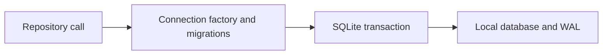

# Wafish.Storage.Sqlite

[README](README.md) · [Agent notes](AGENTS.md) · [Proposed work](PLAN.md) · [Project index](../../docs/projects.md)

## Intro

This project implements the storage contracts with SQLite and optional SQLCipher-compatible encryption through SQLite3MC.

## Real-world example

A branch-office gateway stores routes and audit records locally. It restores the saved configuration after a restart.

## Real-world value

A gateway can retain its state without operating a separate database server.

## What it does

- Initialize connections and apply ordered schema migrations.
- Persist configuration snapshots with version checks and transactions.
- Store plugin state, logs, audit history, notifications, and AI records.

## What it does not do

- Provide a shared multi-node configuration consensus system.
- Replace the host responsibility for protecting encryption keys and backup files.

## Start here

Source project: [Wafish.Storage.Sqlite.csproj](Wafish.Storage.Sqlite.csproj).
Direct project references: [Wafish.Storage.Abstractions](../Wafish.Storage.Abstractions/README.md).

Build and verification commands are in [AGENTS.md](AGENTS.md). Future work is in [PLAN.md](PLAN.md).

## Review fixes 4–7

Migration 019 adds a binding revision table and transactional change triggers.
Atomic batches reject stale revisions and roll back all changes when any operation fails.
Direct binding writes and configuration identity updates also advance this revision.

## Proxy log time comparisons

Proxy log ranges, ordering, aggregation, and retention compare UTC instants with `julianday(Timestamp)`.
Recent error counts exclude expired and future records.
Migration 020 adds the matching expression index to existing databases.
Existing timestamp text and offsets remain unchanged. New proxy log timestamps use UTC.
SQLite interprets offset-free legacy timestamps as UTC. Comparisons have millisecond precision.
Malformed timestamps produce no comparable instant and remain outside time-range queries.

[Verification for review items 8–10](../../tests/Wafish.Regression/evidence/review8910/README.md).

## Review items 14–16

Stored timestamps use invariant UTC round-trip text with seven fractional digits and a `Z` suffix.
Migration 021 normalizes valid legacy timestamps while preserving their instants and precision.
Offsetless legacy text is interpreted as UTC. Invalid text and null values remain unchanged.
Migration pages contain at most 256 records and support composite keys and WITHOUT ROWID tables.
Readers normalize parsed timestamps to UTC. Proxy-log range comparisons retain indexed `julianday` semantics.
Register `TimeProvider` before storage registration to control recent-log windows and retention cutoffs.

Verification: [review evidence](../../tests/Wafish.Regression/evidence/review141516/README.md).

## Query bounds and ordering

Requested history and log limits clamp to 1–500. Empty datasets still return empty collections.
Proxy-log pages use 64-bit offsets. Page numbers below one select the first page.
Proxy-log string filters are limited to 1,024 characters. Longer filters throw `ArgumentException`.
The administration history endpoint retains its 200-row limit and returns HTTP 400 for oversized filters.

Proxy logs sort by timestamp descending, then numeric ID descending. Counts and rows share a read transaction.
Configuration history uses creation time descending, then version ID descending.
Audit history uses timestamp descending, then audit ID descending.
AI sessions use last activity descending, then session ID descending.
Message history selects recent insertion IDs and returns them in ascending order.
Delivery history uses insertion ID descending. Analysis uses insertion ID, with severity first where requested.

Stable datasets have no duplicate or skipped rows across pages. Concurrent writes can shift later offset-based pages.
Retention operations retain their existing limits and behavior. Repeated reads now use deterministic tie breakers.
Consumers requesting zero, negative, or oversized read limits must account for normalization.

The provider-neutral suite accepts an isolated fixture factory and uses repository interfaces only.
See [contract checks](../../tests/Wafish.Regression/StorageConformanceChecks.cs) and [verification](../../tests/Wafish.Regression/evidence/storage-reliability/README.md).

## Recovery and offline verification

Caller cancellation rolls back an unfinished migration. The backfill-specific timeout remains a separate bounded recovery policy.
Fault tests cover migration body failures, ledger failures, cancellation, and process termination with committed WAL data.

Use [the storage tool](../../tools/Wafish.Storage.Tool/README.md) to inspect or verify a standalone backup.
Inspection reports integrity, encryption format, applied migrations, and pending migrations.
Restore verification migrates a private copy and checks configuration records, references, and JSON readability.
Original backups remain unchanged. Unknown schema versions and active WAL/journal companions are rejected.

A 50,000-row regression query must stay below 64 MiB of managed allocations and ten seconds.
These are fixture limits, not guarantees for arbitrary database sizes, record sizes, or hardware.
SQLite work still depends on native query execution. Cancellation is checked through supported command and row operations.

## Differential snapshot writes

Snapshot saves compare persisted fields inside the expected-version transaction.
Only changed or removed rows are deleted. New and changed rows are inserted.
Unchanged routes, clusters, and destinations remain stored without rewriting.
Changed-cluster destinations are restored after possible cascade deletion.
Stable identities, binding renames, version checks, and rollback remain atomic.

With 3,000 routes, changing one route writes two rows instead of 6,004 rows.
The measured WAL shrank from 1,141,272 bytes to 41,232 bytes.
The focused transaction took approximately 24 ms, versus 81 ms before this change.
These local measurements establish reduced write work; timings depend on the host and workload.
