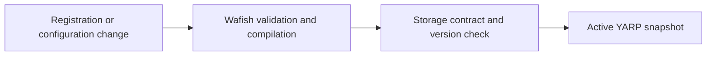

# Wafish

[README](README.md) · [Agent notes](AGENTS.md) · [Proposed work](../../PLAN.md) · [Project index](../../docs/projects.md)

## Intro

The gateway core connects YARP routing, configuration changes, registration, and control-plane access rules.

## Real-world example

An orders service gains a second instance. The gateway updates destinations while existing requests continue using their active configuration.

## Real-world value

Applications can change routing without replacing their gateway host or restarting every backend.

## What it does

- Compile route, cluster, and plugin configuration into versioned snapshots.
- Validate and persist configuration changes before activation.
- Expose REST and gRPC registration support with shared access rules.

## What it does not do

- Provide the React interface or concrete SQLite repositories.
- Replace runtime service registration from Wafish.Runtime.

## Start here

Source project: [Wafish.csproj](Wafish.csproj).
Direct project references: [Wafish.Client](../Wafish.Client/README.md), [Wafish.Grpc](../Wafish.Grpc/README.md), [Wafish.Plugin.Abstractions](../Wafish.Plugin.Abstractions/README.md), [Wafish.Storage.Abstractions](../Wafish.Storage.Abstractions/README.md).

Build and verification commands are in [AGENTS.md](AGENTS.md). Future work is in [PLAN.md](../../PLAN.md).

## Review safety limits

Custom limiter stores implement AcquireAsync and retain ownership until lease disposal. Null indicates partition capacity exhaustion.
See [resource limits and consumer changes](../../docs/security.md#request-resource-limits-and-retry-behavior).

## Review fixes 4–7

Configuration, binding, and discovery writers share one publication gate. Stored revisions remain separate from runtime generations.
`DynamicYarpConfigService.ReconcileAsync` reloads committed storage after an activation failure.
Instance destination updates require `InstanceId` and the expected configuration revision. Peer destinations remain unchanged.
Startup migrates legacy `aneiang.registration.*` ownership and lease keys to `wafish.registration.*` in one configuration transaction.
Conflicting legacy and current values stop startup without changing stored configuration.

## Batch route deletion

Optional orphan cleanup examines surviving cluster references after all requested route deletions.
Shared clusters remain while any surviving route references them.
Deletion and orphan cleanup retain the existing atomic persistence and publication behavior.

[Verification for review items 8–10](../../ARCHIVE.md#archive-tests-wafish-regression-evidence-review8910-readme-md).

Service discovery execution settings include `maxStaleSeconds` and `stalePolicy`.
See [discovery behavior and defaults](../Wafish.Plugin.ServiceDiscovery/README.md#failure-health-and-stale-destinations).

## Asynchronous configuration changes

Mutation APIs accept cancellation through new overloads. Existing overloads remain available.
Preparation awaits YARP validation and snapshot compilation. Lock waits and startup loading observe cancellation.
Cancellation before storage preserves both revisions. Once storage starts, activation and audit retain ownership.
Use `RefreshConfigAsync` in asynchronous callers. The synchronous compatibility method still blocks its caller.
Custom `IDynamicYarpConfigService` implementations must implement the new overloads.
See [verification](../../ARCHIVE.md#archive-tests-wafish-regression-evidence-async-retry-readme-md).

## Configuration response contract

Registration HTTP responses use numeric `status` and named `outcome` fields.
Stored and active revisions remain explicit when confirmed. Caller cancellation reaches precommit configuration work.
Unexpected gRPC failures expose sanitized transport errors.
See [HTTP and gRPC contracts](../../docs/mutation-contracts.md).

Registration ownership metadata uses `wafish.registration.service` and `wafish.registration.instance`.
See [naming migration](../../docs/naming-migration.md#repository-branding-and-configured-names) before upgrading stored registrations.

## Configuration previews and retry receipts

`IConfigurationChangeService` accepts complete route and cluster lists with an expected persisted revision.
Preview returns normalized configuration, identity-level differences, and validation errors without saving or publishing.
Live configuration health errors remain unchanged. Existing plugin bindings participate in validation.
Apply requires an idempotency key and an atomic receipt-capable storage provider.
Matching retries return the original result, including activation failures, without creating another revision.
Changed payloads with the same key return a version conflict.
Cancellation is accepted before persistence. Commit, activation, and receipt completion retain ownership afterward.
Existing CRUD methods retain their contracts. Idempotency applies only to this new workflow.
See [limits and examples](../../docs/configuration-changes.md).

## Instance leases

Instance registration supports expiring leases and graceful draining. Lease state persists with destination configuration.
Configuration previews include active WAF exclusions. Legacy registration cannot replace leased ownership.

See [registration and operations](../../docs/registration-operations-contracts.md) for limits, configuration, and compatibility.

## Atomic change sets

Versioned change sets combine routes, clusters, and plugin bindings in one transaction.
See [change-set contracts](../../docs/configuration-policy-contracts.md) for API examples, revisions, permissions, and recovery.

## Route redirects

The `redirect` plugin supports fixed targets, path and host templates, and HTTPS enforcement.
Routes can omit clusters. Active redirects run before YARP requires a backend.
Other requests on routes without clusters return `503`.
Manage bindings and preview sample requests through the existing plugin editor.
See the [redirect reference](../Wafish.Plugin.Redirect/README.md) for validation, policies, and setup.

Internal route contracts expose prepared GET batches with explicit disposal and bounded response bytes.
`GatewaySnapshot.RouteUidsById` retains stable route identities without changing the existing snapshot constructor.
`IGatewaySnapshotValidator` lets route compilers reject invalid cross-route dependencies before publication.
`RequestExecutionSnapshot` pins plugin execution plans during internal child execution.

External-login bindings participate in route validation and snapshot compilation.
The compiler removes derived authentication metadata before recompilation and rejects duplicate bindings.
Host registration and request enforcement belong to [Runtime](../Wafish.Runtime/README.md).

## Named local quota contracts

[LocalQuotaGroupPolicy](Models/LocalQuotaGroupPolicy.cs) validates and normalizes named quota settings during compilation.
Policy fingerprints use effective algorithm settings and cannot be supplied by binding configuration.
[IGroupedRateLimiterStore](Infrastructure/State/IGroupedRateLimiterStore.cs) adds optional group ownership without changing `IRateLimiterStore`.
The runtime's rate-limit compiler checks policy conflicts before persistence. Preview does not allocate limiter state.
See [configuration and limits](../Wafish.Plugin.RateLimit/README.md#named-route-quotas).

## Compression encoding policy

[CompressionEncodingPolicy](Models/CompressionEncodingPolicy.cs) validates optional encoding restrictions and per-encoding levels.
Compilation copies the encoding list. Omitted fields preserve the shared level and both supported encodings.
See [configuration](../Wafish.Plugin.Compression/README.md#encoding-restrictions-and-separate-levels).
