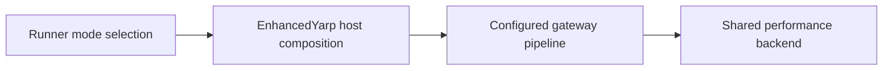

# EnhancedYarp

[README](README.md) · [Agent notes](AGENTS.md) · [Proposed work](PLAN.md) · [Project index](../../../docs/projects.md)

## Intro

This executable hosts WafIsh variants for performance and resilience scenarios.

## Real-world example

The runner selects a mode to compare core registration, storage, runtime services, retry, or circuit behavior.

## Real-world value

Separate host modes help locate the cost and behavior of additional gateway components.

## What it does

- Listen on loopback port 5302 and forward to the performance backend.
- Select host composition with the --mode option.
- Create supported retry and circuit bindings for their functional scenarios.

## What it does not do

- Prove a feature is active merely because a mode has that feature in its name.
- Provide a production deployment or reusable business backend.

## Start here

Source project: [EnhancedYarp.csproj](EnhancedYarp.csproj).
Direct project references: [WafIsh](../../../src/WafIsh/README.md), [WafIsh.Administration](../../../src/WafIsh.Administration/README.md), [WafIsh.Storage.Sqlite](../../../src/WafIsh.Storage.Sqlite/README.md).

Examples include `--mode=host-native`, `--mode=core`, `--mode=full`, `--mode=retry`, and `--mode=circuit`.
Use the [runner](../Runner/README.md) instead of starting conflicting benchmark processes manually.

Build and verification commands are in [AGENTS.md](AGENTS.md). Future work is in [PLAN.md](PLAN.md).

## Review fixes 4–7

WAF, rate-limit, logging, retry, and circuit modes install explicit bindings. Health returns 503 until activation and validation finish.
Unknown modes fail startup. Proxy log settings use `Gateway:ProxyLog`.
`full` enables pipeline composition without implicit route or cluster policies.
