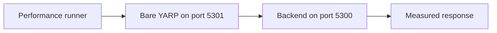

# NativeYarp

[README](README.md) · [Agent notes](AGENTS.md) · [Proposed work](PLAN.md) · [Project index](../../../docs/projects.md)

## Intro

This executable provides the bare YARP baseline for gateway performance comparisons.

## Real-world example

The runner sends the same payload through bare YARP and WafIsh, then compares throughput and latency.

## Real-world value

A minimal baseline helps separate proxy overhead from additional gateway behavior.

## What it does

- Listen on loopback port 5301.
- Forward the performance route to the shared backend on port 5300.
- Expose a health endpoint for runner startup checks.

## What it does not do

- Load WafIsh plugins, storage, or administration services.
- Act as evidence that unrelated production topologies have the same performance.

## Start here

Source project: [NativeYarp.csproj](NativeYarp.csproj).
This project has no direct solution project references. Package and framework references remain in its project file.

Use the [runner](../Runner/README.md) to coordinate this host with the shared backend.

Build and verification commands are in [AGENTS.md](AGENTS.md). Future work is in [PLAN.md](PLAN.md).
