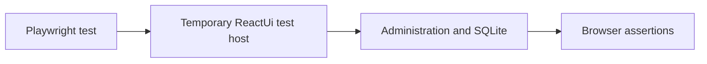

# WafIsh.ReactUi.Host

[README](README.md) · [Agent notes](AGENTS.md) · [Proposed work](PLAN.md) · [Project index](../../docs/projects.md)

## Intro

This test-only ASP.NET Core host supplies real administration APIs for browser verification.

## Real-world example

Playwright starts separate JWT, BasicAuth, and API-key hosts, then checks the same workspace against each authentication mode.

## Real-world value

Browser tests can verify real authentication and persistence instead of mocking every API.

## What it does

- Create isolated encrypted SQLite storage and temporary authentication state.
- Serve the React workspace and administration APIs with seeded demo configuration.
- Use UI_TEST_PASSWORD, UI_TEST_AUTH, and UI_TEST_PORT for test setup.

## What it does not do

- Provide a deployable production example.
- Forward demo traffic to a real business backend; its seeded destination is deliberately inert.

## Start here

Source project: [WafIsh.ReactUi.Host.csproj](WafIsh.ReactUi.Host.csproj).
Direct project references: [WafIsh.ReactUi](../../src/WafIsh.ReactUi/README.md), [WafIsh.Storage.Sqlite](../../src/WafIsh.Storage.Sqlite/README.md).

Playwright assigns ports 5219–5224 and generates a password when none is supplied.
Use the [browser configuration](../../src/WafIsh.ReactUi/ClientApp/playwright.config.ts) to start this fixture.

Build and verification commands are in [AGENTS.md](AGENTS.md). Future work is in [PLAN.md](PLAN.md).

`UI_TEST_PATH_BASE`, `UI_TEST_UI_PREFIX`, and `UI_TEST_API_PREFIX` select deployment prefixes.
Defaults retain root hosting with `/console` and `/aneiang`.
Browser verification uses three additional hosts on ports 5222–5224 with `/edge/manage/ui` and `/edge/manage/api`.
These fixtures cover JWT, BasicAuth, and API-key authentication with isolated storage and credentials.
HTTPS fixture selection remains separate work.
