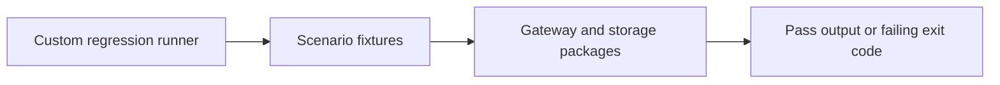

# WafIsh.Regression

[README](README.md) · [Agent notes](AGENTS.md) · [Proposed work](PLAN.md) · [Project index](../../docs/projects.md)

## Intro

This executable runs the main gateway regression checks. It uses a custom runner rather than a unit-test framework runner.

## Real-world example

A developer changes snapshot persistence and runs this project to check rollback, registration, storage, and request behavior.

## Real-world value

The suite catches behavior changes across package boundaries before a release.

## What it does

- Exercise configuration transactions, security boundaries, registration, plugins, storage, and streaming.
- Use real temporary SQLite databases and focused HTTP fixtures.
- Provide storage-only and live Redis modes, plus an administration route contract export.

## What it does not do

- Run through dotnet test as a conventional test-framework project.
- Replace browser workflows, administration integration checks, or performance measurements.

## Start here

Source project: [WafIsh.Regression.csproj](WafIsh.Regression.csproj).
Direct project references: [WafIsh](../../src/WafIsh/README.md), [WafIsh.Administration](../../src/WafIsh.Administration/README.md), [WafIsh.Storage.Sqlite](../../src/WafIsh.Storage.Sqlite/README.md).

Options: `--storage`, `--redis`, and `--dashboard-routes`.
Live Redis checks require `ANEIANG_REDIS_SERVER` to identify a Redis server executable.

Build and verification commands are in [AGENTS.md](AGENTS.md). Future work is in [PLAN.md](PLAN.md).
