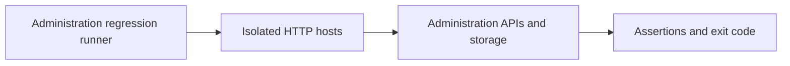

# Wafish.Administration.Regression

[README](README.md) · [Agent notes](AGENTS.md) · [Proposed work](PLAN.md) · [Project index](../../docs/projects.md)

## Intro

This executable verifies administration APIs against isolated running hosts and real storage.

## Real-world example

A developer changes authentication and checks that API keys, JWT login, realtime hubs, and MCP still enforce access rules.

## Real-world value

Management behavior can be tested without relying on a browser or Razor presentation.

## What it does

- Exercise administration deployment, authentication, APIs, backups, and realtime communication.
- Check optional AI and MCP registration.
- Verify persistence across host restarts and reject corrupted authentication state.

## What it does not do

- Test React rendering or browser accessibility.
- Measure gateway throughput or run as a normal production host.

## Start here

Source project: [Wafish.Administration.Regression.csproj](Wafish.Administration.Regression.csproj).
Direct project references: [Wafish.Administration](../../src/Wafish.Administration/README.md), [Wafish.Storage.Sqlite](../../src/Wafish.Storage.Sqlite/README.md).

Build and verification commands are in [AGENTS.md](AGENTS.md). Future work is in [PLAN.md](PLAN.md).

## Review regression coverage

HTTPS checks use real cookie containers and pinned test certificates.
They cover login, logout, expiry, origin rejection, transport isolation, and authentication attempt limits.

## Machine-readable results

Set `WAFISH_TEST_REPORT` to a JSON output path before running the executable.
Schema version 1 includes suite, case name, duration, status, and exception details.
Normal exits write reports, including focused modes and failed assertions.
Process termination cannot guarantee a report. CI also retains console logs.

The authorization matrix checks all 87 mapped administration actions across four authentication modes.
It tests anonymous, invalid, and authorized credentials without invoking action side effects.
`--authorization-matrix` selects the matrix. `--sessions` also runs cleanup and session lifecycle checks.
Session tests use controlled time and real HTTP/WebSocket connections.
See [verification](../Wafish.Regression/evidence/administration-lifecycle/README.md).

Shutdown checks hold authenticated overview and traffic sockets while notifications remain queued or in flight.
They verify connection closure, exact notification accounting, and credential exclusion.

Mutation contract checks cover model validation, configuration and registration writes, plugin persistence faults, and AI plugin discovery.
Error assertions require Problem Details, named outcomes, and nullable revision fields.

Use `--permissions` for operation policy checks. Use `--previews` for permission and preview endpoint checks.
The complete suite includes these checks and the controller authentication matrix.

Run `--need-seven` for WAF exclusion previews and audits, operational endpoints, and unsupported backup handling.
The full suite also checks new routes in the authorization matrix and verifies encrypted WAL backups.
See [feature contracts](../../docs/need-seven-features.md).
