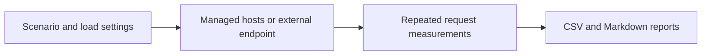

# Runner

[README](README.md) · [Agent notes](AGENTS.md) · [Proposed work](../../../PLAN.md) · [Project index](../../../docs/projects.md)

## Intro

This executable drives repeatable load scenarios and writes performance comparison reports.



## Real-world example

A developer compares bare YARP and selected Wafish modes using repeated warmup and measurement phases.

## Real-world value

Reports connect latency, throughput, errors, and available process measurements to a defined scenario.

## What it does

- Run managed benchmark hosts or target an existing endpoint in external mode.
- Control warmup, duration, concurrency, repetition, and supported scenario suites.
- Write CSV and Markdown results under tests/Wafish.Performance/results.

## What it does not do

- Treat external-mode zero CPU or memory values as measured zero usage.
- Produce statistically portable production capacity guarantees from one local run.

## Start here

Source project: [Runner.csproj](Runner.csproj).
This project has no direct solution project references. Package and framework references remain in its project file.

A short managed run, from the repository root:

```bash
dotnet build Wafish.slnx -c Release
dotnet run --project tests/Wafish.Performance/Runner -c Release --no-build -- --duration 2 --warmup 1 --concurrency 8 --repetitions 1
```

Managed mode uses loopback ports 5300–5302.
For an existing Aspire gateway, use `--external-url` with its reported URL and an appropriate `--path`.
External mode leaves the target services running.

Build and verification commands are in [AGENTS.md](AGENTS.md). Future work is in [PLAN.md](../../../PLAN.md).

## Review fixes 4–7

Managed and external failures return nonzero exit codes. Rate-limit scenarios accept only HTTP 429 as expected rejection.
Reports separate expected rejections from transport failures. Each request has a ten-second deadline covering headers and response reads.

## Isolated and attributable runs

Select distinct loopback origins with `--backend-url`, `--native-url`, and `--enhanced-url`.
Defaults remain ports 5300, 5301, and 5302.
Use `--results-directory` for report output and `--payload-mode=precomputed|generated` for upstream allocation behavior.
Both `--option=value` and `--option value` forms work.
`--modes=native,core,full,waf` selects baseline comparisons; omit it to run all eight modes.
The first suite always runs its complete scenario matrix.

Managed runs own private database directories and remove only those directories.
Workload preflight runs before warmup and rejects invalid status, payload, size, or stalled bodies.
External preflight checks successful status and bounded body completion.
Each request has a ten-second deadline. Run shutdown has a separate bounded deadline.

Latency storage uses a fixed logarithmic histogram, under 32 KiB per run.
Percentiles use the upper bound of the nearest-rank bucket.
Relative error is at most one percent above one microsecond.
Absolute error is at most one microsecond below that threshold.
The supported range ends at 24 hours. Every completed request contributes one sample.

Each Markdown and CSV report has an adjacent JSON report.
It records runtime, operating system, CPU, architectures, GC mode, source revision, and dirty state.
It also records workload settings, transport, histogram bounds, effective host manifests, and configuration hashes.
External reports explicitly mark process measurements unavailable.
Short verification runs establish correctness, not production throughput.

## Matched transports

Use `--transport=http1|h2c|https1|https2` for matching client and upstream protocols.
See [transport setup](../Shared/README.md#matched-transports-r43) for certificate handling and comparison commands.

## Scheduled arrivals (R44)

`--arrival-rate=100` offers 100 requests per second independently of response completion.
`--concurrency` bounds active workers. `--arrival-queue=128` bounds waiting requests.
A full queue drops the new arrival; it never blocks the producer.
Late scheduler wakeups preserve the intended arrival timestamps. Arrivals missed past the phase end count as dropped.
`--arrival-rate=0` preserves the default closed-loop model.

Rate bounds are 0–100,000 per second. Queue capacity is 1–65,536 requests.
Each phase is limited to one hour. Each dispatched request retains its ten-second deadline.
Queued work drains after the offered-load phase, with an overall twelve-second drain deadline.
Unstarted requests at that deadline count as `cancelledBeforeStart`.

Use scheduled arrivals with the baseline suite or external mode. The functional `first` suite remains closed-loop.

```bash
dotnet run --project tests/Wafish.Performance/Runner -c Release --no-build -- \
  --modes=native,full --arrival-rate=1000 --arrival-queue=128 \
  --concurrency=16 --duration=10 --warmup=2 --repetitions=3
```

JSON schema version 3 and CSV/Markdown reports separate:

- Offered arrivals, started attempts, queue drops, and cancellation before dispatch.
- Completed response bodies, request failures, policy rejections, and transport failures.
- Queue delay, service latency from dispatch, and latency from the scheduled arrival.

`offered = started + dropped + cancelledBeforeStart` after drain.
`requests` counts finished attempts, including failures. `completedResponses` counts complete response bodies, including HTTP errors.
Queue delay includes scheduler lateness. Latency percentiles cover dispatched attempts; dropped requests have no response latency.
RPS uses elapsed time including drain. Offered RPS uses the configured phase duration.
Drops remain visible overload measurements; they do not alone fail the process. Request failures still fail it.
Keep the arrival model and offered rate equal when comparing gateways.

## Paced streaming (R42)

Use `--workload=chunks` or `--workload=events` instead of the default baseline payloads.
Configure `--stream-chunks=8`, `--stream-bytes=1024`, and `--stream-interval=50` in milliseconds.
The backend bounds are described in its [streaming guide](../Backend/README.md#paced-streams-r42).
The selected workload replaces the payload matrix for each selected gateway.
Transport selection and scheduled arrivals also apply to streams. The functional first suite uses its existing workloads.
For an external streaming endpoint, use `--external-url` and `--path`.

```bash
dotnet run --project tests/Wafish.Performance/Runner -c Release --no-build -- \
  --modes=native,full --workload=events --stream-chunks=8 --stream-interval=50 \
  --concurrency=2 --duration=10 --warmup=1 --repetitions=3
```

Reports record first response-body byte latency separately from complete-body service latency.
They also report response bytes, body read count, sample count, and the largest observed read gap per response.
A large first-byte delay near completion can indicate buffering.
Reads can combine or divide backend chunks. Read counts do not claim to measure network packets or emitted chunks.
First-byte and read-gap statistics include complete, nonempty response bodies only. Failed bodies remain in failure counters.
Each request uses an eight-KiB pooled read buffer. The client never retains the complete measured body.
Preflight independently validates the complete bounded payload and event framing before measurement.
JSON schema version 4 records streaming settings. CSV appends the delivery measurements.

## Plugin combinations (R47)

Use `--suite=plugins` with an explicit list of up to eight sets.
Separate sets with semicolons and plugins with plus signs. Quote the argument in the shell.
Use `none` for the Wafish host without enabled route plugins. Native YARP is always included for comparison.
Duplicate sets, repeated plugins, empty entries, and unknown IDs fail before managed hosts start.

```bash
dotnet run --project tests/Wafish.Performance/Runner -c Release --no-build -- \
  --suite=plugins '--plugin-sets=none;waf+rate-limit;response-cache+compression' \
  --duration=10 --warmup=3 --concurrency=16 --repetitions=3
```

Supported IDs are `waf`, `rate-limit`, `response-cache`, `compression`, `traffic-metrics`, and `request-retry`.
The default sets are `none;waf;waf+rate-limit;response-cache+compression`.
The harness does not generate a power set. `--modes` and external endpoints are not supported with this suite.

All sets receive `/api/perf/cacheable-json` and `Accept-Encoding: gzip`.
The synthetic backend response explicitly permits public caching for 60 seconds.
Transport, scheduled arrivals, and streaming workload options can also be selected.
Preflight decompresses and validates the payload. Measured requests read encoded bytes without client decompression.
Response-byte metrics therefore describe encoded body bytes, excluding transport headers and framing.

Each set starts a fresh host with private storage. Bindings use manifest order and validated preset settings.
Readiness requires exactly the selected bindings, active execution plans, and healthy plugin resources.
JSON schema version 5 records requested sets, effective settings, versions, order, and configuration hashes.
CSV and Markdown rows identify each set by its canonical name. Hashes link rows to effective manifests.

| Plugin | Preset |
|---|---|
| WAF | Enabled, default rules |
| Rate limit | Fixed window, 1,000,000 permits/second, global partition, no queue |
| Response cache | 60-second TTL, one-MiB body limit |
| Compression | Gzip negotiation, `Fastest`, zero minimum size |
| Traffic metrics | Request and response bytes enabled |
| Retry | Two retries, 10 ms backoff, no jitter, five-second attempt and ten-second total deadlines |

These presets measure selected combinations under successful traffic. They do not represent every production policy.
Preflight warms cache entries, even with zero warmup. Compare those rows as warm-cache workloads.
Streaming responses use `no-store`, so their cache bindings do not store response bodies.
Use the functional first suite for rejection, retry, and circuit recovery scenarios.
