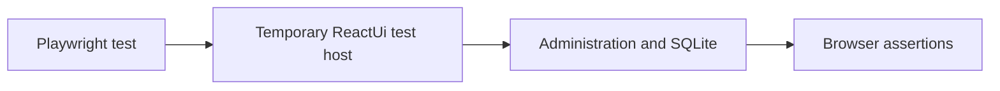

# Wafish.ReactUi.Host

[README](README.md) · [Agent notes](AGENTS.md) · [Proposed work](../../PLAN.md) · [Project index](../../docs/projects.md)

## Intro

This test-only ASP.NET Core host supplies real administration APIs for browser verification.

## Real-world example

Playwright starts separate JWT, BasicAuth, and API-key hosts, then checks the same workspace against each authentication mode.

## Real-world value

Browser tests can verify real authentication and persistence instead of mocking every API.

## What it does

- Create isolated encrypted SQLite storage and temporary authentication state.
- Serve the React workspace and administration APIs with seeded demo configuration.
- Use UI_TEST_PASSWORD, UI_TEST_AUTH, and UI_TEST_PORT for test setup.

## What it does not do

- Provide a deployable production example.
- Forward demo traffic to a real business backend; its seeded destination is deliberately inert.

## Start here

Source project: [Wafish.ReactUi.Host.csproj](Wafish.ReactUi.Host.csproj).
Direct project references: [Wafish.ReactUi](../../src/Wafish.ReactUi/README.md), [Wafish.Storage.Sqlite](../../src/Wafish.Storage.Sqlite/README.md).

Playwright assigns ports 5219–5227 and generates a password when none is supplied.
Use the [browser configuration](../../src/Wafish.ReactUi/ClientApp/playwright.config.ts) to start this fixture.

Build and verification commands are in [AGENTS.md](AGENTS.md). Future work is in [PLAN.md](../../PLAN.md).

`UI_TEST_PATH_BASE`, `UI_TEST_UI_PREFIX`, and `UI_TEST_API_PREFIX` select deployment prefixes.
Defaults retain root hosting with `/console` and `/wafish`.
Browser verification uses three additional hosts on ports 5222–5224 with `/edge/manage/ui` and `/edge/manage/api`.
These fixtures cover JWT, BasicAuth, and API-key authentication with isolated storage and credentials.
HTTPS fixture selection is implemented.

`UI_TEST_HTTPS=true` enables an ephemeral test certificate with loopback subject names.
The certificate and private key remain in process memory. Browser fixtures accept this test certificate only within test configuration.
HTTPS fixtures use ports 5225–5227 with nested prefixes and all three browser authentication modes.
`npm run test:e2e` uses a parent runner that owns a private temporary root.
It stops child processes and removes fixture state after success, failure, or handled interruption.
`UI_TEST_ROOT` selects that parent-owned root. Direct host execution still owns its individual temporary directory.
`npm run test:fixtures` checks cleanup after failed launches, failed runs, and interrupted child processes.
Uncatchable termination of the parent cannot execute cleanup. It must be handled by the surrounding job environment.

## Reusable fixture profiles

`UiTestFixtureOptions` validates process settings before fixture creation.
`UiTestFixture` owns its host, private directory, and in-memory certificate.
Database pooling is disabled for these fixtures. Cleanup does not clear other hosts' connection pools.
Startup failures and repeated disposal release the owned state.
Authentication modes use the same setup and separate directories, ports, and credentials.

Select a profile with `UI_TEST_PROFILE`:

| Profile | Seed or failure |
|---|---|
| `baseline` | One demo route and cluster. This is the default. |
| `large` | The demo route plus 250 numbered routes. |
| `plugins` | Enabled rate-limit and compression bindings on the demo route. |
| `storage-failure` | Configuration writes return `StorageFailed` before persistence. |
| `version-conflict` | An independent stored revision causes `VersionConflict`. |
| `delayed-failure` | Writes wait 1.5 seconds, then return `StorageFailed`. |
| `activation-failure` | Persistence succeeds; publication returns `ActivationFailed`. |

Failures activate after startup. They use the actual mutation pipeline and revision response fields.
Profiles have no HTTP fault-control endpoints and require no external backend.
Browser checks use additional HTTPS hosts on ports 5228–5233 for these six profiles.
Port 0 requests an isolated operating-system port for C# fixture tests.
See [infrastructure evidence](../Wafish.Regression/evidence/regression-infrastructure/README.md).

The opt-in `passkeys` fixture profile enables WebAuthn for `https://localhost:<fixture-port>`.
Its credential file remains inside the owned temporary directory.
Browser tests use a virtual authenticator to verify enrollment, login, revocation, and password recovery.
