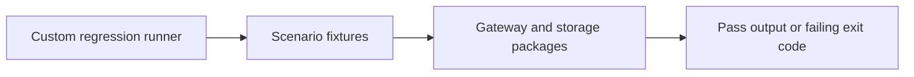

# Wafish.Regression

[README](README.md) · [Agent notes](AGENTS.md) · [Proposed work](../../PLAN.md) · [Project index](../../docs/projects.md)

## Intro

This executable runs the main gateway regression checks. It uses a custom runner rather than a unit-test framework runner.



## Real-world example

A developer changes snapshot persistence and runs this project to check rollback, registration, storage, and request behavior.

## Real-world value

The suite catches behavior changes across package boundaries before a release.

## What it does

- Exercise configuration transactions, security boundaries, registration, plugins, storage, and streaming.
- Use real temporary SQLite databases and focused HTTP fixtures.
- Provide storage-only and live Redis modes, plus an administration route contract export.

## What it does not do

- Run through dotnet test as a conventional test-framework project.
- Replace browser workflows, administration integration checks, or performance measurements.

## Start here

Source project: [Wafish.Regression.csproj](Wafish.Regression.csproj).
Direct project references: [Wafish](../../src/Wafish/README.md), [Wafish.Administration](../../src/Wafish.Administration/README.md), [Wafish.Storage.Sqlite](../../src/Wafish.Storage.Sqlite/README.md).

Options: `--storage`, `--redis`, and `--dashboard-routes`.
Live Redis checks require `WAFISH_REDIS_SERVER` to identify a Redis server executable.
Use `--group registration-migration` for legacy ownership, port replacement, lease protection, and failed migration checks.

Build and verification commands are in [AGENTS.md](AGENTS.md). Future work is in [PLAN.md](../../PLAN.md).

## Review regression coverage

Live Kestrel checks cover retry, cache, compression, YARP replay, response-start boundaries, and disconnect cancellation.

Review items 4–7 add deterministic publication barriers, atomic binding batches, live circuit retries, and lifecycle checks.
Run `--review-lifecycle` for focused checks. [Evidence](../../ARCHIVE.md#archive-tests-wafish-regression-evidence-review4567-readme-md) includes managed benchmarks and live Redis verification.

Review items 8–10 add log shutdown accounting, notification classification, UTC queries, orphan cleanup, and metrics finalization.
Run `--review-accounting` for ten focused checks. [Evidence](../../ARCHIVE.md#archive-tests-wafish-regression-evidence-review8910-readme-md) records full regression and coverage results.

Review items 11–13 add prefixed shell checks, owned domain shutdown, cache-key compatibility, and compression threshold cases.
Run `--review-deployment` for six focused checks.
[Evidence](../../ARCHIVE.md#archive-tests-wafish-regression-evidence-review111213-readme-md) also records browser, asset validation, and package checks.

## Machine-readable results

Set `WAFISH_TEST_REPORT` to a JSON output path before running the executable.
Schema version 1 includes suite, case name, duration, status, and exception details.
Normal exits write reports, including focused modes and failed assertions.
Process termination cannot guarantee a report. CI also retains console logs.
Use `--review-release` for controlled-clock, retention, and UTC migration checks.

## Redis and discovery recovery

Run `--recovery` for controlled connection failures, provider fixtures, per-binding health, stale policies, and live proxy expiry.
Run `--redis` for live connection replacement, deployment key isolation, interrupted Lua operations, and restart recovery.
The standard runner includes all `--recovery` cases.
[Verification evidence](../../ARCHIVE.md#archive-tests-wafish-regression-evidence-recovery-readme-md) records commands, results, and changed-source coverage.

`--async-policy` runs nine configuration cancellation, concurrency, and retry deadline groups.
See [verification](../../ARCHIVE.md#archive-tests-wafish-regression-evidence-async-retry-readme-md).

`--storage-reliability` runs ten storage contract, recovery, query-budget, and backup-verification groups.
It includes a forced child-process stop against isolated test databases.
See [verification](../../ARCHIVE.md#archive-tests-wafish-regression-evidence-storage-reliability-readme-md).

## Lifetime stress selection

Run `dotnet run --project tests/Wafish.Regression -c Release -- --lifetime-stress` for nine focused groups.
Checks cover domain replacement, collectible unloading, circuit probes, native limiter boundaries, and partition churn.
The collectible fixture builds as a separate assembly and loads only through collectible contexts.
See [evidence](../../ARCHIVE.md#archive-tests-wafish-regression-evidence-lifetime-stress-readme-md).

## Contract selection

Run `dotnet run --project tests/Wafish.Regression -c Release -- --contracts` for mutation, registration, wire, and lifecycle checks.
The selection covers transport uncertainty, caller cancellation, partial startup, audit shutdown, and plugin interface compatibility semantics.
Package API break detection runs separately through `tests/Wafish.PackageChecks/check-negative.py`.

## Case selection and fault replay

The shared registry defines every case before starting fixtures.
Default execution runs each case once and excludes the opt-in live Redis integration.
Existing focused flags remain available. Unknown selections return exit code 2.
Failed checks return 1. Successful checks and dry listings return 0.

```bash
dotnet run --project tests/Wafish.Regression -c Release -- --list
dotnet run --project tests/Wafish.Regression -c Release -- --group fault-schedules
dotnet run --project tests/Wafish.Regression -c Release -- --case 'Fault schedules: audit loading retains recent writes within the capacity limit' --seed 91
```

`--list` emits JSON without starting hosts, storage, or network fixtures.
`--case` selects an exact scenario name. `--group` selects a named group.
`--seed` selects a signed 32-bit seed. Default fault runs use 17, 91, and 2026.
Named barriers control persistence, publication, audit loading, retry delays, and log draining.
Timeouts detect deadlocks; they do not select the operation order.

Set `WAFISH_TEST_REPORT` to write a JSON report.
Schema version 1 includes each case name, group, duration, status, and exception details.
Scheduled cases also include seeds, ordered operations, and replay commands, including on failure.
Tests do not include fixture passwords in schedule traces.
`--ui-fixtures` verifies isolated profiles, authentication modes, HTTPS, failed starts, and failure responses.

See [infrastructure evidence](../../ARCHIVE.md#archive-tests-wafish-regression-evidence-regression-infrastructure-readme-md).

`--protocol-properties` checks the WAF corpus, seeded decoding, cache-header combinations, compression negotiation, and concurrent metrics.
Use `--seed <integer>` to reproduce generated WAF and metric inputs.
WAF corpus diagnostics appear in console output and JSON schedule metadata.

`--benchmarks` verifies bounded measurements, cancellation, preflight, manifests, and owned process cleanup.
Build the Release solution first; this group launches the performance host binaries.

`--allocation-pressure` measures cache, streaming compression, and differential snapshot writes.
`--sample-deployment` verifies topology naming, Sonar readiness, and operator links.
`--sample-contracts` verifies proxied sample endpoints, identity, trace correlation, health filters, and telemetry sources.

Configuration preview and receipt checks: `dotnet run --project tests/Wafish.Regression -c Release -- --group configuration-changes`.
Plugin preview checks: `dotnet run --project tests/Wafish.Regression -c Release -- --group plugin-preview`.
These cover restart retries, rollback, activation failures, receipt limits, candidate cleanup, and unchanged active traffic.

## Need-seven feature checks

Run `--group need-seven` for registration leases, readiness, storage capabilities, backups, histograms, cache purge, WAF policies, and diagnostics.
Checks include controlled clocks, held requests, pending fills, provider timeouts, and restart persistence.
See [contracts](../../docs/registration-operations-contracts.md) and [evidence](../../ARCHIVE.md#archive-tests-wafish-regression-evidence-need-seven-readme-md).

## Need-6 follow-up

Run `--group need-six` for cache sharing, recovery jitter, combined change sets, gateway failover, maintenance, and EndpointSlice contracts.
See [verification evidence](../../ARCHIVE.md#archive-tests-wafish-regression-evidence-need-six-readme-md).

## Release candidate verification

The solution includes the collectible plugin fixture so Release builds produce the required Release assembly.
Legacy database tests dispose reopened connections before reading file headers, including on Windows.
See [candidate evidence](../../ARCHIVE.md#archive-tests-wafish-regression-evidence-release-candidate-readme-md).

Use `--group internal-routes` for child routing, authorization preflight, context isolation, response bounds, cancellation, and snapshot retention.
Use `--group aggregation` for JSON composition, template validation, admission, deadlines, policy parity, and atomic dependency repairs.

## External login

Run `--group external-login` for configuration, CSRF, OIDC callback, cookie isolation, refresh, and authorization checks.
Set `WAFISH_EXTERNALLOGIN_REDIS` to an isolated Redis instance to enable the live session and gateway checks.
Each check uses an isolated namespace and temporary key directory.
The group verifies repeat login, refresh fencing, two gateway replicas, native policies, and administration isolation.
Use the [Aspire browser sample](../../samples/SampleExternalLogin/README.md) for real Keycloak verification.

## Named local quotas

Run `dotnet run --project tests/Wafish.Regression -c Release --no-build -- --group named-quotas`.
[NamedQuotaChecks.cs](NamedQuotaChecks.cs) verifies shared permits, client isolation, policy conflicts, route changes, cancellation, and bounded ownership.
Real HTTP and SQLite checks verify rejection before persistence and counter retention after binding recreation.

## Compression measurements

Run `dotnet run --project tests/Wafish.Regression -c Release --no-build -- --group compression-metrics`.
[CompressionMetricChecks.cs](CompressionMetricChecks.cs) verifies byte totals, trailers, exclusions, failures, timing, cardinality, and runtime registration.
`--sample-contracts` verifies that sample telemetry exports the compression meter.
The full regression includes negotiation properties, streaming checks, and allocation-pressure limits.

## Compression encoding policies

Run `dotnet run --project tests/Wafish.Regression -c Release --no-build -- --group compression-policy`.
[CompressionPolicyChecks.cs](CompressionPolicyChecks.cs) verifies allowed encoding subsets, quality negotiation, independent levels, and validation before persistence.
The full suite also retains compression measurement, protocol-property, and streaming coverage.

## Combined Redis quotas

Run `dotnet run --project tests/Wafish.Regression -c Release --no-build -- --group dual-quotas`.
[RedisDualWindowChecks.cs](RedisDualWindowChecks.cs) covers validation, persistence rejection, middleware headers, optional store support, and command dispatch.
The existing `--redis` selection also verifies combined windows with real Redis counters and a single-primary Redis Cluster.
It covers concurrent replicas, rejected-request accounting, independent rollover, natural expiry, deployment prefixes, and cluster key placement.
Set `WAFISH_REDIS_SERVER` to a Redis 7 or later executable. The runner owns isolated processes, ports, and temporary data.

### Blue-green walkthrough

Run `--group blue-green` for isolated administration API cutover and rollback checks.
The check preserves route UID, transforms, metadata, and unrelated routes across backend version switches.
It also checks failed candidate health gating and active/persisted version agreement.
See the [operator walkthrough](../../docs/blue-green.md).

### Multiple benchmark destinations

The `--benchmarks` group checks bounded destination lists, rejected topologies, and matching native/Wafish balancing policies.
It verifies measured distribution across two backends for all four supported transports.
Single-backend managed and external comparisons retain their existing checks.

Use `--group tenant-quotas` for trusted Redis tenant identity, immutable key compilation, bounds, and configuration rejection.
The `--redis` checks also verify tenant sharing, cardinality, isolation, and expiry against isolated standalone and cluster instances.

Use `--group weighted-quotas` for atomic request costs, mixed-cost groups, native queue cancellation, and large retry values.
Run `--lifetime-stress` after changes to limiter ownership, queues, or partition capacity.

### Sample streaming

Run `dotnet run --project tests/Wafish.Regression -c Release -- --group sample-streaming`.
This group verifies bounded sample records through real HTTP and active cache, compression, and retry bindings.
It checks early delivery, disconnect cancellation, no-transform enforcement, cache exclusion, and no replay after deadline interruption.

### Streaming compression

Run `dotnet run --project tests/Wafish.Regression -c Release -- --group streaming-compression`.
Checks cover flush-policy validation, real Gzip/Brotli delivery, no-transform, cancellation, deadlines, ownership, and unchanged defaults.
The local diagnostic reports output size, throughput, and managed allocation without buffering its output.
Its timing is illustrative and does not qualify a performance baseline.

### Discovery catalog

Run `dotnet run --project tests/Wafish.Regression -c Release -- --group discovery-catalog`.
Checks cover bounded loopback origins, atomic membership, invalid controls, synthetic failures, empty responses, and OpenAPI.
Use `python3 scripts/check-service-discovery.py` for the isolated Aspire scenario, with the target AppHost stopped.

## Telemetry configuration report

`--group telemetry-configuration` verifies opt-in startup output, environment restrictions, secret redaction, and registration snapshots.
It checks that diagnostics add no HTTP route. Existing `--sample-contracts` checks verify actual instrumentation behavior.
The [live script](../../scripts/check-telemetry-configuration.py) verifies enabled and disabled Aspire resource reports.

## Idempotent sample orders

`--group sample-orders` verifies atomic duplicates, conflicts, bounded capacity, expiry, cancellation, HTTP validation, and OpenAPI.
A real gateway fixture retries a committed order after a bodyless failure and checks its original result.
The sample scope is one backend process. Independent stores deliberately create independent results.
