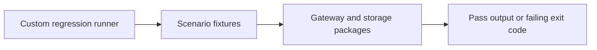

# Wafish.Regression

[README](README.md) · [Agent notes](AGENTS.md) · [Proposed work](PLAN.md) · [Project index](../../docs/projects.md)

## Intro

This executable runs the main gateway regression checks. It uses a custom runner rather than a unit-test framework runner.



## Real-world example

A developer changes snapshot persistence and runs this project to check rollback, registration, storage, and request behavior.

## Real-world value

The suite catches behavior changes across package boundaries before a release.

## What it does

- Exercise configuration transactions, security boundaries, registration, plugins, storage, and streaming.
- Use real temporary SQLite databases and focused HTTP fixtures.
- Provide storage-only and live Redis modes, plus an administration route contract export.

## What it does not do

- Run through dotnet test as a conventional test-framework project.
- Replace browser workflows, administration integration checks, or performance measurements.

## Start here

Source project: [Wafish.Regression.csproj](Wafish.Regression.csproj).
Direct project references: [Wafish](../../src/Wafish/README.md), [Wafish.Administration](../../src/Wafish.Administration/README.md), [Wafish.Storage.Sqlite](../../src/Wafish.Storage.Sqlite/README.md).

Options: `--storage`, `--redis`, and `--dashboard-routes`.
Live Redis checks require `WAFISH_REDIS_SERVER` to identify a Redis server executable.

Build and verification commands are in [AGENTS.md](AGENTS.md). Future work is in [PLAN.md](PLAN.md).

## Review regression coverage

Live Kestrel checks cover retry, cache, compression, YARP replay, response-start boundaries, and disconnect cancellation.

Review items 4–7 add deterministic publication barriers, atomic binding batches, live circuit retries, and lifecycle checks.
Run `--review-lifecycle` for focused checks. [Evidence](evidence/review4567/README.md) includes managed benchmarks and live Redis verification.

Review items 8–10 add log shutdown accounting, notification classification, UTC queries, orphan cleanup, and metrics finalization.
Run `--review-accounting` for ten focused checks. [Evidence](evidence/review8910/README.md) records full regression and coverage results.

Review items 11–13 add prefixed shell checks, owned domain shutdown, cache-key compatibility, and compression threshold cases.
Run `--review-deployment` for six focused checks.
[Evidence](evidence/review111213/README.md) also records browser, asset validation, and package checks.

## Machine-readable results

Set `WAFISH_TEST_REPORT` to a JSON output path before running the executable.
Schema version 1 includes suite, case name, duration, status, and exception details.
Normal exits write reports, including focused modes and failed assertions.
Process termination cannot guarantee a report. CI also retains console logs.
Use `--review-release` for controlled-clock, retention, and UTC migration checks.

## Redis and discovery recovery

Run `--recovery` for controlled connection failures, provider fixtures, per-binding health, stale policies, and live proxy expiry.
Run `--redis` for live connection replacement, deployment key isolation, interrupted Lua operations, and restart recovery.
The standard runner includes all `--recovery` cases.
[Verification evidence](evidence/recovery/README.md) records commands, results, and changed-source coverage.

`--async-policy` runs nine configuration cancellation, concurrency, and retry deadline groups.
See [verification](evidence/async-retry/README.md).

`--storage-reliability` runs ten storage contract, recovery, query-budget, and backup-verification groups.
It includes a forced child-process stop against isolated test databases.
See [verification](evidence/storage-reliability/README.md).

## Lifetime stress selection

Run `dotnet run --project tests/Wafish.Regression -c Release -- --lifetime-stress` for nine focused groups.
Checks cover domain replacement, collectible unloading, circuit probes, native limiter boundaries, and partition churn.
The collectible fixture builds as a separate assembly and loads only through collectible contexts.
See [evidence](evidence/lifetime-stress/README.md).

## Contract selection

Run `dotnet run --project tests/Wafish.Regression -c Release -- --contracts` for mutation, registration, wire, and lifecycle checks.
The selection covers transport uncertainty, caller cancellation, partial startup, audit shutdown, and plugin interface compatibility semantics.
Package API break detection runs separately through `tests/Wafish.PackageChecks/check-negative.py`.

## Case selection and fault replay

The shared registry defines every case before starting fixtures.
Default execution runs each case once and excludes the opt-in live Redis integration.
Existing focused flags remain available. Unknown selections return exit code 2.
Failed checks return 1. Successful checks and dry listings return 0.

```bash
dotnet run --project tests/Wafish.Regression -c Release -- --list
dotnet run --project tests/Wafish.Regression -c Release -- --group fault-schedules
dotnet run --project tests/Wafish.Regression -c Release -- --case 'Fault schedules: audit loading retains recent writes within the capacity limit' --seed 91
```

`--list` emits JSON without starting hosts, storage, or network fixtures.
`--case` selects an exact scenario name. `--group` selects a named group.
`--seed` selects a signed 32-bit seed. Default fault runs use 17, 91, and 2026.
Named barriers control persistence, publication, audit loading, retry delays, and log draining.
Timeouts detect deadlocks; they do not select the operation order.

Set `WAFISH_TEST_REPORT` to write a JSON report.
Schema version 1 includes each case name, group, duration, status, and exception details.
Scheduled cases also include seeds, ordered operations, and replay commands, including on failure.
Tests do not include fixture passwords in schedule traces.
`--ui-fixtures` verifies isolated profiles, authentication modes, HTTPS, failed starts, and failure responses.

See [infrastructure evidence](evidence/regression-infrastructure/README.md).

`--protocol-properties` checks the WAF corpus, seeded decoding, cache-header combinations, compression negotiation, and concurrent metrics.
Use `--seed <integer>` to reproduce generated WAF and metric inputs.
WAF corpus diagnostics appear in console output and JSON schedule metadata.

`--benchmarks` verifies bounded measurements, cancellation, preflight, manifests, and owned process cleanup.
Build the Release solution first; this group launches the performance host binaries.

`--allocation-pressure` measures cache, streaming compression, and differential snapshot writes.
`--sample-deployment` verifies topology naming, Sonar readiness, and operator links.
`--sample-contracts` verifies proxied sample endpoints, identity, trace correlation, health filters, and telemetry sources.

Configuration preview and receipt checks: `dotnet run --project tests/Wafish.Regression -c Release -- --group configuration-changes`.
Plugin preview checks: `dotnet run --project tests/Wafish.Regression -c Release -- --group plugin-preview`.
These cover restart retries, rollback, activation failures, receipt limits, candidate cleanup, and unchanged active traffic.

## Need-seven feature checks

Run `--group need-seven` for registration leases, readiness, storage capabilities, backups, histograms, cache purge, WAF policies, and diagnostics.
Checks include controlled clocks, held requests, pending fills, provider timeouts, and restart persistence.
See [contracts](../../docs/need-seven-features.md) and [evidence](evidence/need-seven/README.md).

## Need-6 follow-up

Run `--group need-six` for cache sharing, recovery jitter, combined change sets, gateway failover, maintenance, and EndpointSlice contracts.
See [verification evidence](evidence/need-six/README.md).

## Release candidate verification

The solution includes the collectible plugin fixture so Release builds produce the required Release assembly.
Legacy database tests dispose reopened connections before reading file headers, including on Windows.
See [candidate evidence](evidence/release-candidate/README.md).
